---

Estudante do 3.º ano de **Engenharia Informática** na [NOVA FCT](https://www.fct.unl.pt/).

- 🎖️ **Academia Militar** (2009–2015)
- 🗺️ **Centro de Informação Geoespacial do Exército** (2019-...)
- 🔗 [LinkedIn](https://www.linkedin.com/in/pedro-salas-simoes)

### Projetos
   - 🏠 [DomusRoom](https://pedro22-cpu.github.io/portfolio/) — projeto de Interação Pessoa-Máquina (NOVA FCT, em grupo)

---

### Estatísticas

